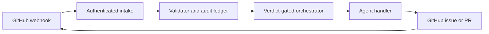

# Architecture

GitHub records hold work and review state. Tools expose narrow operations over
those records. Agents propose content and code, while validation and orchestration
control which events may advance the workflow. PostgreSQL stores a hash-chained
audit ledger. This describes source responsibilities, not a deployed service.

## Core flow

Queue, consumer, ledger, and dispatcher interfaces separate the policy logic from
runtime adapters. The existing Azure implementation is experimental; the [local PostgreSQL runtime](local-runtime.md) implements these interfaces.
It commits authenticated intake and its receipt atomically. Validator audit, verdict,
outgoing work and acknowledgement share a transaction; orchestration likewise
commits agent jobs and settlement together. Renewable leases and fencing guard
queue ownership. Live agent jobs await activation and worker integration; the
explicit control-plane demo uses a synthetic receipt-only worker. A separate
[isolated coding executor](isolated-worker.md) uses the existing SDK adapter and
durable CodingJob leases to return patches and command receipts from disposable
containers. It accepts explicit operator requests and does not publish PRs.

### Records

#### Primitives

| Primitive | Purpose |
| --- | --- |
| **Issue** | Work item with a kind marker |
| **Pull Request** | Proposed implementation |
| **Review** | Feedback and approval record |
| **Release** | Versioned delivery, experimental |
| **Deployment** | Environment delivery, experimental |

#### Issue kinds

| Kind | Purpose |
| --- | --- |
| **Goal** | Desired outcome, experimental |
| **Spec** | Acceptance criteria, experimental |
| **Design** | Implementation design, experimental |
| **Task** | Bounded work |
| **Incident** | Operational event, experimental |
| **Decision** | Recorded rationale, experimental |

The validator uses `kind:*` labels and per-record finite state machines. Its
accepted verdict authorizes routing; agent output is still subject to repository
policy. Hash chaining can reveal ledger alteration, but is not an external
immutable anchor or proof that every remote effect happened exactly once.

## Initial product boundary

The intended supported flow is Task to Build to Review to CI to human merge.
The current source also contains broader planning and operations handlers. Their
presence does not establish a supported autonomous lifecycle. Human review and
merge enforcement, workflow integration, and live installation checks must be completed
before this candidate can become a usable alpha.

See [generated diagrams](architecture-diagrams.md) for source-derived counts,
[Azure adapter vocabulary](design/azure-adapter.md) for experimental roles, and
[source authority](sources-of-truth.md) for the implementation map.
