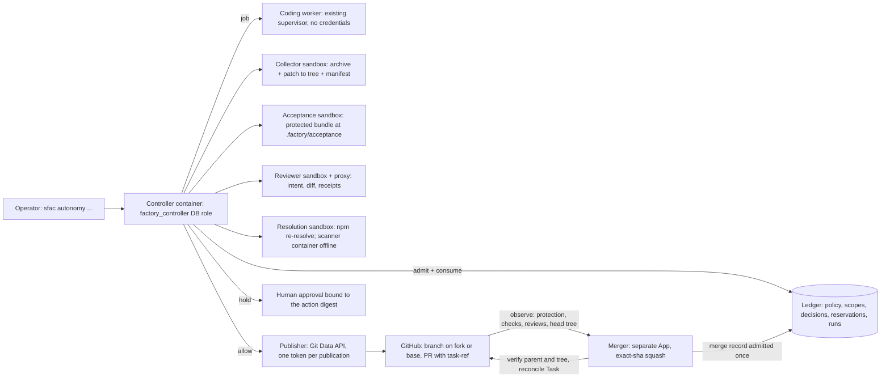

# Operating bounded autonomy

**Status: implemented, not the default. Live qualification passed on commit 039c43a ([`evals/qualification/039c43a.json`](../evals/qualification/039c43a.json)); the candidate has changed since, so the current checkout is not itself the qualified commit.** That run showed a routine change executed, published and squash-merged by the merger App with no human step; critical changes held at publication or merge; a controller killed mid-execution recovered with no second execution; a revoked scope refusing publication, merge and new attempts; base publication refused without the secretless-CI attestation; and a held critical merge unlocked by the owner's native review of the exact head. The controller,
trusted runners and publisher also pass synthetic contracts (fixture executor,
real sandboxes, PostgreSQL, a Git-hashing fixture host). The default alpha workflow
stays human-gated; this mode is enabled explicitly.

Bounded autonomy lets routine work go from an authorized Task to a published pull
request without a human step, while critical, out-of-scope or uninspectable changes
wait for a human approval bound to that exact revision. The
[policy contract](autonomy-policy.md) defines the decision; this page describes the
machinery that produces its evidence and how an operator runs it.

## What runs where



| Component | Runs as | Credentials | Network |
| --- | --- | --- | --- |
| Controller (`src/autonomy/cli.ts`) | supervisor container, `factory_controller` role | controller DB password; in live mode the App key (source reads), model key (proxy only), publisher App key | GitHub, model provider |
| Coding worker | disposable container, uid 1000 | none (proxy holds the model key) | none |
| Collector, acceptance, reviewer sandboxes | disposable containers, uid 1000, read-only, no capabilities | none | none; the reviewer reaches its proxy through a socket volume |
| Resolution sandbox | disposable container | none | outbound network (Docker bridge); the project's manifest, lockfile or `.npmrc` naming any non-registry source is refused before npm runs (transitive limit below) |
| Scanner (Trivy adapter) | disposable container from the pinned image | none | none; reads an operator-maintained database cache volume |
| Publisher | inside the controller process | publisher App installation token, minted with `contents: write, pull_requests: write, metadata: read`, restricted to the write and base repositories, revoked after use. One token covers both repositories with the same permission set (a GitHub token limitation), so in fork mode the installation on the base repository also holds `contents: write` even though only pull requests are written there | GitHub |
| Merger (`src/autonomy/merger.ts`, `merge-controller.ts`) | inside the controller process, live only, `FACTORY_AUTOMERGE=enabled` | merger App installation token, minted per merge with `contents: write, pull_requests: write, metadata: read` on the base repository only, revoked after use; a different App from the publisher | GitHub |
| Internet-facing runtime | `factory_runtime` role | unchanged | unchanged; `SELECT` only on autonomy tables |

The controller holds Docker daemon authority, as the existing supervisor does. The
worker, the sandboxes and the scanner never hold a credential.

## Configuration

Run `./sfac init` with autonomy selected:

- Demo (credential-free): `./sfac init --mode demo --autonomy`. Fixture reviewer, no
  scanner (add `--scanner fixture` and a policy `dependencies` block to exercise dependency
  verification with the fixture scanner), no publisher; the pipeline runs end to end and
  stops in `held` with reason `publication_disabled` and both decisions recorded, because
  nothing can be published without GitHub.
- Live: `./sfac init --mode live --execution bounded --reviewer claude --reviewer-model claude-… --publication fork --fork-repository OWNER/REPO --fork-repository-id ID --publisher-app-id ID --publisher-installation-id ID …`
  plus the usual live arguments. Base publication instead takes `--publication base
  --secretless-ci-attested` (you attest the base repository's pull-request CI holds no
  secrets; `init` refuses base publication without it).
  `--scanner trivy --scanner-image REF --scanner-cache-volume NAME` enables dependency
  verification. Fork mode needs the fork to contain the Task's base
  commit (keep it synced with the base) and the publisher App installed on both. Fork pull
  requests run the base repository's `pull_request` workflows without secrets, but
  `pull_request_target` and `workflow_run` workflows run with the base's secrets: a base
  repository with such workflows acting on pull-request content must not enable bounded
  publication in either mode. Add `--automerge --merger-app-id ID --merger-installation-id ID
  --merger-app-slug SLUG` to let routine pull requests merge without a human; see
  [Merging](#merging).

`init` creates `secrets/controller_database_password` for the controller role, which
`./sfac build && ./sfac up` provisions through the migration. Then provide, in the state
directory (`.factory/` by default):

| File | Purpose |
| --- | --- |
| `autonomy-policy.json` | The [policy](autonomy-policy.md); start from [`runtime/autonomy-policy.example.json`](../runtime/autonomy-policy.example.json). Pin `acceptanceSuiteSha256`, `acceptanceHarnessSha256`, `acceptanceRunnerImage`, `reviewerConfigSha256` and, when enabled, the scanner adapter and image. |
| `acceptance/` | The protected acceptance bundle: `harness.json` plus test files. See below. |
| `secrets/publisher_private_key` | Live only: the publisher App's private key. |
| `secrets/merger_private_key` | Live only, `--automerge`: the merger App's private key. A second App, installed on the base repository only. Mounted only into the `merge` and `merge-scan` commands' container (`live-automerge-supervisor`); every other autonomy command runs without it. |
| `merge-policy/merge-policy.json` | Live only: the [human merge profile](human-merge.md), alone in its directory (the review services mount `merge-policy/` read-only) and read again before every look of the merge gate; with `--automerge` it also names the merger (`"merger": {"appSlug", "appId"}`), see [`runtime/merge-policy.automerge.example.json`](../runtime/merge-policy.automerge.example.json). |
| `secrets/model_key` | Live only: the model key, held by the proxy for the worker and the reviewer. |

Activate the policy, then grant a scope:

```sh
./sfac autonomy activate --acknowledge initial_activation,mode_changed:human_gated->bounded,...
./sfac autonomy intent 42                    # prints the Task's node id and intent digest
./sfac autonomy grant --scope goal-1 --tasks I_TASK_NODE_ID=INTENT_SHA256 --budget-usd 5 --max-runs 2 --expires-hours 48
./sfac autonomy status
```

A live grant names each Task together with the intent digest `intent` printed, so the
grant covers the issue as the owner read it: an issue edited afterwards has another
digest and is refused with `scope_intent_mismatch` until the owner grants it again.
Demo grants may name Tasks alone.

`activate` refuses until every weakening it computes is acknowledged by exact code;
it prints the list it expected. A demo installation acknowledges
`initial_activation` and, for a bounded policy, `mode_changed:human_gated->bounded`.

## Running a Task

```sh
./sfac autonomy run TASK_NUMBER --scope goal-1          # live
./sfac autonomy run 1 --scope goal-1 --task-file /artifacts/task.json --archive /artifacts/source.tar.gz   # demo
```

The controller admits an `execute` request, runs the worker once, collects the frozen
change, runs the protected acceptance suite (and the reproducer for `bugfix` Tasks),
the fresh-context reviewer and, when the change touches npm manifests and a scanner is
configured, dependency verification. It then admits `publish`. Outcomes:

| Run state | Meaning | Next |
| --- | --- | --- |
| `published` | PR opened or updated on the exact tested tree; paired and tracked when the merge policy is configured | `./sfac autonomy merge TASK_NUMBER` (or `merge-scan`) decides the merge; see [Merging](#merging) |
| `held` | `execute_approval_required` or `publish_approval_required`: a human must approve the recorded `actionSha256` | `./sfac autonomy approve --action SHA --kind KIND --approver GITHUB_USER_ID`, where `KIND` is `execute` or `publish` (the kind the hold names), then `run` again; receipts older than `receiptTtlMs` are verified again before the decision |
| `repair` | Acceptance failed or the reviewer found important defects; a new attempt was started with the findings appended to the prompt, within the scope's run limit | nothing; the next attempt continues automatically |
| `blocked` | Policy or ledger refused an admission, for example budget (`scope_budget_exhausted`), run limit (`task_run_limit_reached`), intent mismatch (`scope_intent_mismatch`), missing or malformed evidence. Pause, revocation and expiry refuse at the start of `run` without changing state; one that lands while a controller is already driving the attempt blocks it at its next admission (`autonomy_paused`, `scope_revoked`, `scope_expired`) | fix the cause; `run --new-attempt` starts another attempt |
| `failed` | The worker or collector failed; no external effect. A worker that had already started keeps an `unknown` reservation (spend uncertain) until reconciled. Also: `run` resumed an open attempt whose Task text (`task_changed_during_attempt`) or source commit (`source_moved_during_attempt`; in live mode the default branch head) had changed; an attempt found executing becomes `unknown` instead | `reconcile` if a reservation is open, then `run --new-attempt` if appropriate |
| `unknown` | Execution or publication outcome is uncertain (lost worker lease, dead work item, Task or source changed mid-execution, a failure after the branch was written) | inspect the worker and GitHub, then `./sfac autonomy reconcile --run RUN_ID --spent-usd X` or `--released` settles an open or uncertain reservation (also one left `unknown` under a published run) and frees the Task |
| `cancelled` | `./sfac autonomy cancel TASK_NUMBER`; an executing attempt keeps an `unknown` reservation until reconciled. While a controller is driving the attempt, `cancel` only asks a running worker to stop (`requested`) and that controller records the outcome | `reconcile` when a reservation is open |

A publication that fails before anything is written (GitHub unavailable, token refused)
leaves the run in `publish_admitted` with the reason printed; `run` again retries only
the publication. `run` exits with `task_run_in_progress` while another controller holds
the Task and with `worker_busy` while another worker run holds the repository; nothing
changes in either case. A publication that was written before a crash is found on the
branch and adopted, not recreated.

Re-running `run` on a finished attempt changes nothing; the controller resumes only an
open attempt. A crashed controller resumes from the recorded step: an execution already
admitted is not paid for twice, and a publication already made is found again, not
duplicated. The ledger settles the budget reservation from the worker's estimated cost;
an uncertain outcome keeps the full reservation until an operator reconciles it.

## Merging

With `FACTORY_AUTOMERGE=enabled` (live, bounded), `./sfac autonomy merge TASK_NUMBER`
takes the Task's published attempt through the `merge` decision; `./sfac autonomy
merge-scan` does it for every published attempt whose merge is unsettled. Each merge is a
record beside the run (`factory_autonomy_merges`), stepped by compare-and-set:

| Merge state | Meaning | Next |
| --- | --- | --- |
| `observing` | Trusted reads of the pull request: head and its tree, base, branch protection and CODEOWNERS, required check runs by name and App id, reviews (a request for changes counts from a human with write access or from an installed App, as on GitHub). A condition that can still change keeps the record here with its reason recorded: pending, missing or failed required checks, a request for changes, unverified protection, a stale observation, expired receipts without re-verification, a GitHub refusal (`github_merge_not_allowed`). After three consecutive identical GitHub refusals `merge-scan` leaves the record alone; `merge TASK` retries and resets the count. Receipts older than `receiptTtlMs` are replaced by fresh verification of the same base archive and patch, but only once the observation would otherwise let the merge proceed | the next `merge` or `merge-scan` observes again |
| `held` | `merge_approval_required`: a critical change, `mergeEffect: deployment`, or human-gated mode. The approval is a native `APPROVED` review on the exact head by a configured approver (`approvers.githubUserIds`) who is also a `reviewers` entry of `merge-policy.json`; there is no console approval for merges. A dismissed review unlocks nothing; approving the head again does. `merge-scan` leaves an unapproved hold alone (no decision, no re-verification); `merge` decides it again. `approval_already_used`: the approval for this exact action was consumed at a merge call that did not merge (GitHub refused it, or its outcome was uncertain and it turned out not to have merged) and the admission then expired; `merge-scan` leaves such a record alone and a new attempt is the way on. To keep that rare, an approval by a listed reviewer without write access (one GitHub would not count) is not an approval here either | a review, then `merge` or the next scan |
| `admitted` | The ledger decided `allow` and recorded it. Immediately before merging, the admission must still stand (same active policy, within its TTL, the approving review still present for approval-based admissions; otherwise it is decided again, spending nothing) and the observation is repeated and must still match: same head, base and tree, protection verified, checks passed, no change request. The admission is consumed at the merge call itself, with the token minted and the head confirmed. A condition that can still change (`pre_merge_recheck_failed:…`, a token or read failure) keeps the admission for the next scan | merges |
| `merged` | The merger App squash-merged exactly the head; the merge commit's single parent is the observed base and its tree is the tested tree; the Task is reconciled through the merge gate from the observation recorded immediately before the merge. Until the gate confirms the reconciliation (`evidence.reconciled`), every `merge` or scan repeats it | none |
| `blocked` | Ended: the head, base or tree changed, the pull request was closed or merged by someone else, or the Task changed since publication. `run --new-attempt` publishes a revision when that is the answer | inspect |
| `unknown` | The merge call's outcome is uncertain (connection lost after it went out), or the merge commit does not prove the tested tree on the observed base. `merge-scan` never touches it | `./sfac autonomy merge TASK` settles it from GitHub's facts: a merge that happened is verified and recorded, an untouched open pull request resumes, a closed one ends; a proof mismatch stays `unknown` for a human |

Publication pairs the Task with its pull request the way the [human flow](end-to-end-pilot.md)
does by hand: the factory's App writes exactly one `pr-ref: PULL_NODE_ID` backlink into the
Task body and replaces `status:proposed` with `status:in_review`, then registers the
immutable pair the merge gate verifies. The backlink line is the factory's and is not part
of the Task's intent digest; any other edit to the Task's title, body or definition stops the
attempt: an open attempt that `run` resumes after the edit ends `failed`
(`task_changed_during_attempt`; `unknown` if the worker was executing), and a published
attempt's merge record ends `blocked` (`task_changed_since_publication`). A revision (`run --new-attempt`)
finds the Task paired and the pair registered; a proposed Task that is `status:in_review`
without a published attempt of this factory is refused (`task_not_proposed`).

Routine work merges with no human step: the merger App submits the one approving review
GitHub's protection requires (citing the decision) and merges; whether it approves follows
the ledger's decision, never who else reviewed on GitHub. That approval never outlives its
attempt: when the merge call is refused, the admission dies or the record ends, the merger
dismisses its own review, so a human merger cannot merge on the factory's approval alone. When branch
protection restricts who may dismiss reviews, GitHub lets only that list and repository
administrators dismiss, so leave review dismissal unrestricted or add the merger App to that
list. The observation does not check this setting: a dismissal GitHub refuses leaves the
approval on the pull request, recorded as `dismissal` on the merge record or, after a refused
merge call, making the record `unknown` (`github_review_dismiss_failed`). The
two policy files must name the same base branch (`merge_policy_base_branch_differs_from_autonomy_policy`). Critical work waits for a human
review of the exact head; the merger never approves in its place. Every configured approver
must have write access to the repository (GitHub counts only such reviews) and be listed as
a reviewer in `merge-policy.json` (reconciliation accepts only listed reviewers and the
merger App). The repository's protection for the automatic profile differs from the human
profile in two settings, both enforced by the observation: code-owner review is not
required by GitHub (the policy decides who may approve), and the merger App is the only App
in the push restriction. Nothing bypasses protection; the App is a restricted pusher.
Reconciliation accepts a merge by the merger App only for the exact merge commit the
ledger recorded; any other bot merge parks the pull request for a human.

## Protected acceptance bundle

The bundle is a directory the operator controls. `harness.json`:

```json
{
  "version": 1,
  "runner": { "kind": "node-test" },
  "tests": ["tests/sum.test.mjs"],
  "reproducer": "tests/reproducer.test.mjs",
  "timeoutMs": 60000
}
```

Every other file is the suite. The runner copies the bundle into the candidate tree
at `.factory/acceptance/` after the patch is applied (a candidate that already has that
path cannot be tested), so tests import candidate code with relative paths such as
`../../../sum.js`. `node-test` runs each file in its own process and counts results
from the runner's structured events in the parent process, never from output text or
from a file the candidate's processes could reach (the summary travels through the
runner parent's stdout). A file passes only when its child reports completion of the
whole file: a child that exits early (candidate code called `process.exit(0)`) flushes no
events on the pinned runner, so the file fails. `{"kind":"command","program":"…","args":[…]}`
runs any program per file and trusts only its exit status. The bundle digest is checked
before and after each run, the candidate source is snapshotted around it, and the results
go into the acceptance receipt the policy consumes. See [`examples/autonomy-demo/acceptance`](../examples/autonomy-demo/acceptance).

Limit: candidate code runs inside the same process as the tests that import it, so code
written to defeat the suite (patching `assert`, forging the runner's event stream) can
manufacture a pass. Acceptance is therefore a regression signal against ordinary
mistakes and bundle tampering, not an integrity boundary against a hostile candidate;
the fresh-context reviewer and the approval rules for critical changes are that boundary.

Tests run without network. Projects whose tests need installed dependencies must
vendor them or provide a lockfile-free path; this is the same limit the worker has.

## Dependency verification

When a change touches `package.json` or `package-lock.json`, the resolution sandbox
(the only sandbox with network) first refuses any manifest specifier, lockfile
`resolved` URL or `.npmrc` in the project that could point npm anywhere but the public
registry, then re-resolves the lockfile from the manifest with install scripts disabled
and compares it byte for byte, computes the
package deltas and the changed manifest fields, and the scanner adapter reports
vulnerabilities over the committed lockfiles from an offline database cache. The Trivy
adapter runs the pinned image with `fs --scanners vuln --format json --skip-db-update
--skip-java-db-update --offline-scan` against a read-only cache volume; refresh that
volume with `docker run --rm --mount type=volume,src=NAME,dst=/cache IMAGE image
--cache-dir /cache --download-db-only` on a schedule you choose. Other ecosystems are
reported `unsupported` and stay critical. Limit: the refusal covers the project's own
files; a registry package whose metadata names a git or URL dependency would still make
npm fetch it from that host over the bridge, after which the lockfile fails to reproduce
and the change holds. A registry-pinned egress proxy for this sandbox is future work.
The adapter was verified once by hand against
`aquasec/trivy@sha256:62b1e65e8869bc4b4c6aa4fa2b21595256c7c2f6018a9d9ad61caf87187c1969`
(September 27, 2026: offline scan of a lockfile with known advisories, findings read from
`Results[].Vulnerabilities[]`, database age from `metadata.json` `UpdatedAt`); pin the
digest you verify yourself, since the policy refuses a tag.

## Recovery and boundaries

`./sfac autonomy recover` removes orphaned worker and sandbox containers, then
reports. It refuses with `controller_busy` while any controller command is active, so a
live run's sandboxes are never swept. It never repeats paid work; `unknown` runs need an
operator decision, recorded with `./sfac autonomy reconcile` (a PR found on GitHub is
paired through the existing `worker record-pr` path). Controller commands serialize on
rows of `factory_autonomy_locks`, which the internet-facing runtime role cannot touch. Pause (`./sfac autonomy pause --reason …`) stops all admission and all resumption of open attempts (`run` reports `autonomy_paused` and changes nothing); revocation and expiry stop a scope's attempts the same way. Pause stops admission
immediately; revocation stops a scope. The controller CLI is not reachable from a
webhook or the runtime process; it runs when an operator (or an operator-scheduled
job) invokes it.

Not supported: repositories whose archive differs from their tree (`export-ignore`
attributes); the publisher reports `publish_base_tree_mismatch` and nothing is written.
Ignore rules and attribute filters in the repository do not matter: snapshots track every
archived file byte for byte.

Not yet provided: GitHub-review–sourced
approvals for execute and publish holds (those take the console approval; a merge hold takes
only a native review), a revision path for a `blocked` merge other than a new attempt, and
scheduling.
