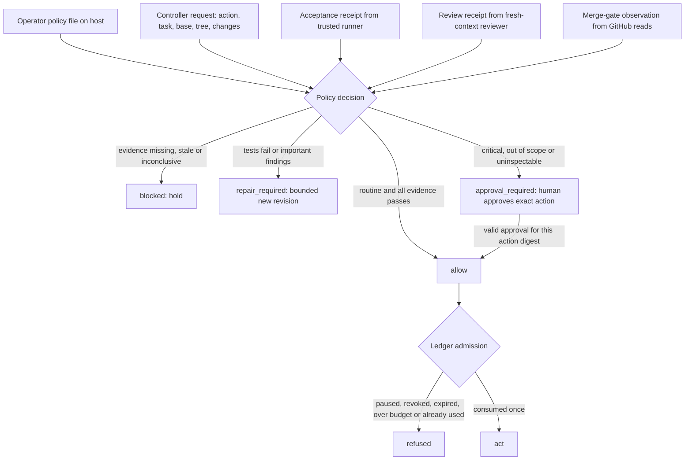

# Trusted autonomy policy

**Status: contract and decision library only.** No runtime path consumes it yet.
The supported workflow remains human-gated: explicit activation, operator
publication, native human review and human merge. Automatic execution,
publication and merge are planned work (see [roadmap](roadmap.md)); nothing in
this document enables them.

The policy decides, for one proposed consequential action, whether the factory
may proceed without a human. Routine work inside configured scope proceeds once
machine evidence passes. Critical, out-of-scope or uninspectable changes hold for
a human approval bound to that exact action. Missing, stale, malformed or
inconclusive evidence never counts as a pass.

Source: `services/local-runtime/src/autonomy/` (policy, classification, evidence,
decision, ledger) and migration `0008_autonomy_policy.sql`.

## Decision flow

Precedence is `blocked` > `repair_required` > `approval_required` > `allow`.
A human approval never converts a failed test, an unresolved finding or missing
evidence into a pass.

## Policy file

The operator selects an absolute host path. The file must be a regular file (not
a symlink), not group- or world-writable, and at most 64 KiB. It is never read
from a PR branch, Task text, labels, worker output or model output. See
[`runtime/autonomy-policy.example.json`](../runtime/autonomy-policy.example.json).

| Field | Meaning |
| --- | --- |
| `revision` | Strictly increases on each activation; an older document cannot be replayed. |
| `mode` | `human_gated` (every action needs a human, today's behavior) or `bounded`. |
| `repository` | Exact name, numeric ID, installation ID and base branch. |
| `allowedPaths` | Path prefixes routine work may change; `.` means the whole repository. |
| `criticalPaths` | Extra `{path, category}` rules. They add to the built-ins and cannot remove them. |
| `execution` | Allowed models, and per-run turns, duration and budget (micro-USD); per-scope budget and per-Task attempt ceilings. |
| `changeLimits` | Largest change that can be routine; larger changes need a human. |
| `mergeEffect` | `deployment` holds every merge for a human. There is no `unknown`. |
| `verification` | Trust roots: acceptance suite, harness and runner image digests, reviewer configuration digest, eval protocol digest, in-repository protected paths and receipt lifetime. |
| `approvers` | Numeric GitHub user IDs allowed to approve holds. |

Limits cannot exceed the worker's own ceilings (60 turns, 30 minutes, USD 100 per
run, 20 runs per Task). Cost figures are SDK estimates, not provider bills or hard
spending caps.

### Changing the policy

The **active** policy assesses its replacement. Activation computes every
weakening (wider paths, removed critical or protected paths, added models or
approvers, raised limits, `human_gated` to `bounded`, `deployment` to `none`, and
any trust-root change) and refuses unless the operator acknowledges exactly that
list. A proposed policy cannot vouch for itself. Existing installations have no
active policy and keep today's behavior; enabling `bounded` is an explicit,
acknowledged activation. Activating a new policy invalidates pending decisions and
every scope granted under the old one; pause state carries over.

## Risk classification

Classification runs on a complete change manifest produced by the trusted
collector from the verified base tree and the frozen candidate tree: every file's
status, both paths, both modes and full text content. Worker-reported diffs are
not used. An incomplete manifest, a traversal path, a `.git` segment or a
duplicate path is refused. Rules are case-insensitive; renames are judged on both
the old and new path.

**Built-in critical paths** (always on): CI and repository automation, CODEOWNERS,
developer hooks, factory configuration, `SECURITY.md`, dependency manifests and
lockfiles, auth/security modules, secret-bearing files, deployment and container
definitions, infrastructure code, migrations and SQL, license and notice files,
plus configured `criticalPaths` and `verification.protectedPaths`.

**Content tripwires** run on changed lines only (added and/or removed), so an
unchanged mention elsewhere in a file does not escalate: auth and crypto code
(including removed checks), code-execution primitives, disabled TLS verification,
hidden text-direction controls, recognizable secrets, credential handling,
permission changes, deployment actions, infrastructure resources, destructive SQL
and filesystem operations, removed license notices, publication commands, and
test skipping or failure masking.

**Test weakening:** deleting or moving a test file out of test locations, or a net
reduction in assertions within a test file, is critical. Adding tests is routine.

**Uninspectable:** binary content, symlinks, submodules, mode changes, non-ASCII
paths, empty changes and changes above `changeLimits` need a human.

These rules are tripwires, not proofs. The deterministic rules and the separate
reviewer must **both** find a change routine; either one can escalate it, and
neither can downgrade the other. Task text, labels and `intentKind` never lower
risk; `bugfix` only adds the reproducer requirement.

Publication is itself an external effect. CI definitions (which run on push) and
recognizable secret material (disclosed once pushed) need approval **before
publish**. Other critical changes may be published for review, but their merge
holds.

## Evidence receipts

Receipts are written by trusted factory code from observed facts: exit statuses
the trusted runner collected, a reviewer's structured output parsed by the
supervisor, and GitHub API reads. Worker output, test logs, PR text and labels are
data inside receipts, never their authors. Unknown fields are refused.

| Receipt | Bound to | Passes only when |
| --- | --- | --- |
| Acceptance | repository, Task, base, tested tree, change digest; suite, harness and runner-image digests | Fresh; `passed` with a non-empty suite, no failures or skips; tests did not modify candidate source; bug fixes have a reproducer that fails on base and passes on the candidate. |
| Review | same subject, intent digest, reviewer configuration digest | Fresh-context, `complete`, no limitations, risk consistent with categories, no high or medium findings. Low findings are nits and never interrupt. |
| Merge gate | repository, base branch, PR head, head tree, base | Observed within 5 minutes; PR open; head tree equals the tested tree; base unchanged; protection verified; required checks passed; no human change request. |
| Approval | action digest (policy, Task, base, head, tree, changes, limits) | From a configured human GitHub user for that exact action. A new head, base, tree or policy needs a new approval. |

A human change request blocks any PR, routine or not. Failed required checks
send the change to repair.

### Protected acceptance trust root

The protected suite and harness are content-addressed bundles pinned by digest
in the policy (`contentTreeDigest` over path, mode and SHA-256 of each file). The
trusted runner mounts them read-only into a fresh verification sandbox with the
frozen candidate tree; it does not reuse the author's processes, configuration or
installed dependencies, and it treats test logs as untrusted data. An in-repository
copy listed in `protectedPaths` is governance-critical to change, and merging such
a change does not update the pinned bundle: only an acknowledged policy activation
can.

### Reviewer permissions

The reviewer receives the approved intent, pinned source, the actual diff and
trusted test receipts. It does not receive the author's conversation or
self-assessment, and it has no authoring, policy, publication or merge authority
or credentials. Optional execution runs in a separate restricted sandbox. Fresh
context reduces shared assumptions; it is not proof of independence or
correctness. It is distinct from regression retesting (which may use prior
findings) and from outside-human onboarding.

## Ledger

`AutonomyLedger` stores policy activations, pause state, standing scopes,
recorded decisions, single-use admissions and budget reservations in PostgreSQL.

- **Scope:** an owner grant listing Tasks, models, a micro-USD budget, a per-Task
  run limit and an expiry of at most 30 days, all within the active policy.
- **Admission:** an `allow` decision is consumed at most once per controller
  request, within 10 minutes. Consumption re-checks active policy, pause, scope
  revocation, expiry and membership, then reserves budget and counts the attempt
  in one serialized transaction.
- **Reservations:** `released` only when execution provably never started;
  `unknown` keeps the full reservation until reconciled; `settled` records the
  estimated cost, which may exceed the reservation.
- **Access:** migrations grant the internet-facing runtime role `SELECT` only and
  revoke anything else on every run. Writes need the trusted operator identity.

## Not provided

No bypass or exception mechanism; no automatic cross-provider substitution; no
exactly-once guarantee for external effects (ambiguous outcomes are reconciled,
not replayed); no protection against a compromised host or operator account.
The planned controller, publisher and merger must still collect these receipts,
use a guarded exact-head merge, and reconcile the actual merge afterwards.
