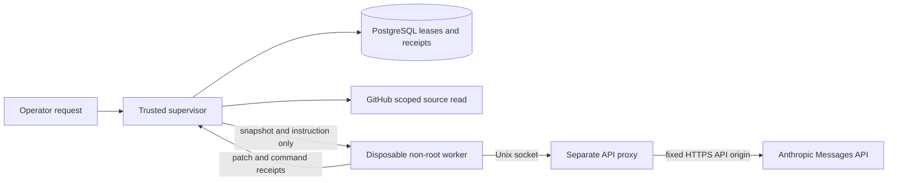

# Isolated coding worker

The local executor runs an explicitly submitted coding job in a disposable Docker
container and returns a patch with command receipts. It uses the existing Claude
Agent SDK adapter. In the default mode, live jobs require a verified human Task
activation and a separate local command. Under opt-in bounded autonomy, the
controller submits jobs authorized by a consumed ledger admission under an
owner-granted scope; see [autonomy operations](autonomy-operations.md).
The [end-to-end walkthrough](end-to-end-pilot.md) connects this executor to explicit
operator publication, required CI, human review/merge and Task reconciliation.

## Run the credential-free example

Requirements: Docker/Compose and a POSIX shell. Follow the [quickstart](quickstart.md)
to initialize, build and start a demo, then run:

```sh
./sfac demo-source coding-input
./sfac worker run coding-input/job.json coding-result coding-input/source.tar.gz
./sfac worker status
```

Inputs and outputs live under `.factory/artifacts/`; choose new names for each
example. The fixed demo job ID supports cached retrieval: repeating it with a new
output directory retrieves the stored result without execution. See
[container operation](container-runtime.md) for paths and command mapping.

The example fixes an arithmetic function and runs Node tests, Python unittest and
shell/tool version commands. It calls no model. Inspect `coding-result/result.json`
and `changes.patch` beneath the artifacts directory. Output is private to your user.
No patch is applied to a host checkout, no PR is created and no Task is completed.

The worker freezes the proposed patch **before** validation. Generated test output
is excluded from that patch and listed in `testSideEffects.generatedPaths`. A test
that changes or deletes a file present before validation fails with
`test_modified_source`, listing `modifiedPaths`. Python bytecode generation is
disabled. Snapshot bounds match the source size/file bounds; excessive or unsupported
side effects fail the run. Tests share the worker UID and can tamper with their own
execution, so these checks are not independent or tamper-proof attestation.
An omitted test list remains `not_run`. Review source and receipts independently.

The trusted supervisor runs in a container with Docker daemon authority; ordinary
operator commands have no socket. PostgreSQL is reachable on the internal Compose
network only. The optional native profile in [local runtime](local-runtime.md)
requires host Python/Node and a loopback database port; it is not required by `sfac`.

## Live request contract

First complete [GitHub installation and human activation](github-installation.md).
The live CLI accepts only `run-activation ACTIVATION_ID NEW_OUTPUT_DIRECTORY`;
arbitrary `run JOB_JSON` requests are demo-only. Before running, set
`FACTORY_EXECUTION=manual` in ignored `.factory/.env` and supply your own Anthropic
key as private `.factory/secrets/model_key`. The Compose service remains intake-only.
Live calls spend your provider quota and must use an exact model ID you selected
and can access; the executor never substitutes a model.

An activation binds an open Task's title, body, labels and identity, its explicit
prompt/tests/model/limits, and the current default-branch commit. The trusted
supervisor rechecks the installation, unchanged comment, current human permission,
Task and source before downloading and again under the execution lease before
starting Docker/model work. Authorization expires one hour after the comment was
created. Edit the Task or move the default branch and a new approval is required.
A revoked permission, deleted/edited comment or unsupported installation stops work.

The Agent SDK is pinned to **0.3.283** (Claude Code 2.1.283). Model metadata
access alone does not prove compatibility with the bundled execution client. A
provider may reject an older client for a newer model before producing a result;
record that failure and its unknown billing rather than treating it as a successful
zero-cost run. Review and test SDK upgrades, then obtain a fresh activation for
an intentional retry. No model is silently substituted.

A live manual job uses an immutable `activation-<receipt UUID>` job ID; a
bounded-autonomy job uses `autonomy-<run UUID>`. A duplicate
submission can return a saved result without another model run; conflicting job
contents fail. A fresh approval is needed for an intentional new run. Leases and
receipts do not make external model effects exactly once. GitHub can change after
the final check; use cancellation to stop a running job if authorization is revoked.

The supervisor mints a GitHub installation token restricted to the configured
repository with `contents:read` and `metadata:read`, validates its returned
scope/expiry, fetches the pinned snapshot and revokes the token before execution.
Unexpected scope, redirect, source identity or revocation failure stops the run.
No GitHub token reaches the worker. There is no Git remote, push capability, merge
credential or App key there. This produces local patch/test artifacts; it does
not publish a PR or change Task status.

The snapshot is transferred through stdin and unpacked inside the container only.
Compressed input is limited to 8 MiB, expanded input to 64 MiB and 4,096 entries.
Traversal, links, devices and embedded `.git` paths are rejected. Submodules, LFS
hydration, symlink-dependent repositories and network dependency installation are
not supported by this profile. Node/npm, Python 3, Bash and Git are installed;
project-specific dependencies must be available in the declared snapshot/image.
There is no Python package manager or general compiler/toolchain promise.

## Trust boundary and outbound access



| Resource | Worker access |
| --- | --- |
| Host home, repository checkout, database, App key, Docker socket | None; no host bind mounts and no direct network |
| Source and temporary files | Ephemeral `/workspace` (512 MiB) and `/tmp` (128 MiB) |
| Image files | Read-only, UID/GID 1000, all capabilities dropped, no new privileges |
| CPU/memory/processes | Two CPUs, 2 GiB memory including swap limit, 128 PIDs; bounded files/open descriptors |
| Model credential | Held only by a separate proxy; absent from worker environment, argv and filesystem |
| Model connection | Read-only named-volume mount containing the Unix socket; worker network namespace is `none` |

The proxy accepts only Messages/count-tokens POST requests for the configured
model at `https://api.anthropic.com`; redirects, arbitrary destinations, unknown
request fields and provider network/MCP tools are rejected. Each request is limited
to 2 MiB and at most 16,384 output tokens; request count is `maxTurns + 4` (maximum
64). The extra requests accommodate SDK accounting/retries, not unlimited turns.
The proxy uses Docker’s shared default bridge with resource limits and a bounded lifetime.
It does not have a dedicated per-run network. Its API key is
passed through stdin, never Docker environment or command arguments. The worker's
SDK sees a non-secret placeholder and a local loopback-to-socket bridge.

Only the explicit environment in `src/worker/protocol.ts` reaches the shell.
User/repository SDK settings, plugins, skills, MCP servers and persistent sessions
are disabled. The available model tools are Read, Write, Edit, Bash, Grep and Glob.
The source remains untrusted even with these settings: prompt injection can alter
code, invoke tools, consume the permitted model requests or send source content to
the configured model provider. The proxy is an application boundary, not a content
filter or proof of provider geography/retention. Vendor processing terms still
apply. The same-UID test harness is not tamper-proof attestation. Containers share
the host kernel; this is not a perfect sandbox, VM boundary or compliance claim.
Use only a trusted local image and patched Docker host. Image distribution and
vendor/OS notice clearance remain separate release gates; see [third-party components](../THIRD_PARTY.md).

## Cancellation, limits and recovery

```sh
./sfac worker cancel operator-request-001
./sfac worker status
./sfac worker recover
```

`cancel` requests cancellation of the configured repository's queued or active job. SIGINT or
SIGTERM to the supervisor also cancels it. The durable cancellation poll runs every
200 ms. The supervisor removes the entire worker/proxy container namespace and
socket volume before settlement, including shell descendants. Worker execution is
bounded by a required 1-second to 30-minute deadline and 1–60 SDK turns; preparation
and cleanup use separately bounded Docker/source calls. Model turn/usage accounting
comes from the SDK and is not an exact dollar cap or provider billing receipt.
The pinned SDK reports `num_turns=2` when a `maxTurns=1` fixture stops with
`error_max_turns`; its reported counter is not a literal count of allowed API calls.
The separate proxy request cap and container deadline remain independent bounds.

A repository-wide supervisor mutex and renewable queue lease prevent concurrent
ordinary execution. Lost ownership aborts the worker and prevents acknowledgement.
Each submitted job has **one execution attempt**; interrupted/failed paid work is
never retried automatically. Cleanup failure remains explicit and blocks later
repository jobs. After a supervisor crash, wait for the prior lease to expire,
then `recover` removes the configured repository's labeled orphan resources before
any new execution is allowed. It refuses recovery while a live supervisor/lease
still owns the run. The next `run` also performs this recovery check. Recovery does
not replay paid work, reverse provider effects or assert exactly-once execution.
A paused/stopped daemon, disconnected database or host crash can delay cleanup;
inspect durable state and restore infrastructure before another attempt.

See [run evidence and controls](run-controls.md) for durable Task/head/test/accounting
summaries, revision and budget limits, publication linkage and content pruning.
`status` reports run ID, image ID, state and bounded reason codes. Completed/failed
command receipts are stored with durable work and copied into the output directory.
If execution cannot return a result, that directory gets `failure.json`; consult
status for timeout, cancellation, lease loss or cleanup failure. Container logs are
disabled and temporary source/credentials disappear on cleanup. A failed artifact
write may leave successful evidence only in the database; repeating the same job
ID with a new output directory retrieves it without a paid retry. Existing runtime
backup/retention guidance applies; receipts may include sensitive repository data.

## Reproduce boundary checks

```sh
python3 runtime/worker/test.py
python3 runtime/test.py
```

The worker suite builds the shipped image and runs actual shell/Node/Python tools,
the installed SDK against a synthetic provider, denial/limit checks, cancellation,
lease loss, cleanup failure and killed-supervisor recovery with disposable
PostgreSQL. It uses no live GitHub credentials or paid model API. The database suite
checks the existing control-plane crash/restart/restore contracts. Real installation,
paid-model compatibility, PR creation and merge are separate end-to-end evidence: the
live qualification of commit `039c43a`
([`evals/qualification/039c43a.json`](../evals/qualification/039c43a.json)) exercised
them through opt-in bounded autonomy.

Boundary references: [Docker security](https://docs.docker.com/engine/security/),
[container resource settings](https://docs.docker.com/engine/containers/run/), and
[scoped GitHub installation tokens](https://docs.github.com/en/rest/apps/apps#create-an-installation-access-token-for-an-app).
