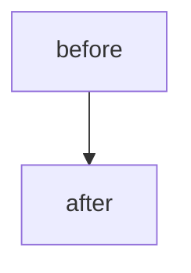

<!--
Generated from {{FACTORY_REPO}}/templates/app-repo/.github/pull_request_template.md
Link the Task this PR implements. The factory pairs a Task and PR through exactly one
`task-ref: TASK_NODE_ID` line in this body and the `pr-ref:` backlink on the Task (added by
the operator, or at bounded-autonomy publication). The validator does not block a PR that
lacks these links.
-->

## Linked Task

<!-- Required by the merge gate. Format: `task-ref: TASK_NODE_ID`, the Task's GitHub node ID. Do not use GitHub auto-closing keywords such as `Closes #N`. -->
task-ref:

## Parent Goal

<!-- Optional, experimental. The validator reads `parent-goal:` only from Spec, Design and Task issue bodies, never from a PR body. Format: owner/repo#N -->
parent-goal:

## Summary

<!-- 1-3 sentences. What changes? Why? -->

## Diagram

<!--
For non-trivial changes, include a Mermaid diagram of the change — `flowchart` for a
flow / process, `stateDiagram-v2` for a lifecycle, `sequenceDiagram` for interactions.
GitHub renders it inline. Omit for trivial / mechanical changes.

-->

## Type of change

- [ ] Code change (`feat` / `fix` / `refactor`)
- [ ] Documentation (`docs`)
- [ ] Test (`test`)
- [ ] CI / build (`ci` / `chore`)
- [ ] Configuration / env (`chore`)

## Surface area

- [ ] Adds a new env var (added to `.env.example`)
- [ ] Adds a new dependency (justified in commit message body)

## Verification

<!-- How did you verify? CI is required but not sufficient. -->

- [ ] CI green (install, lint, type check and test)
- [ ] Ran locally; verified the golden-path manually
- [ ] Updated affected runbook(s) in `docs/runbooks/`
- [ ] No new lint or typecheck warnings

## Rollback

<!-- If this regresses, how do we revert? Reference the runbook if non-trivial. -->
