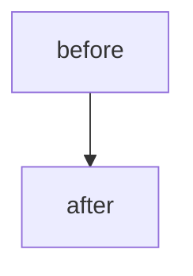

<!--
Generated from {{FACTORY_REPO}}/templates/app-repo/.github/pull_request_template.md
The factory's Validator requires that every PR links to a Task that links to a Goal.
Agents that open PRs without these links cannot merge — the validator blocks transition.
-->

## Linked Task

<!-- REQUIRED. Validator hard-rejects merge if missing. Format: `Closes #N` where N is a Task issue. -->
Closes #

## Parent Goal

<!-- REQUIRED. The Task's parent Goal in machine-readable form. Format: owner/repo#N -->
parent-goal:

## Summary

<!-- 1-3 sentences. What changes? Why? -->

## Diagram

<!--
For non-trivial changes, include a Mermaid diagram of the change — `flowchart` for a
flow / process, `stateDiagram-v2` for a lifecycle, `sequenceDiagram` for interactions.
GitHub renders it inline. Convention (canonical): {{FACTORY_REPO}}/templates/app-repo/AGENTS.md.tpl
(§Documentation conventions). Omit for trivial / mechanical changes.

-->

## Type of change

- [ ] Code change (`feat` / `fix` / `refactor`)
- [ ] Documentation (`docs`)
- [ ] Test (`test`)
- [ ] CI / build (`ci` / `chore`)
- [ ] Configuration / env (`chore`)

## Surface area

- [ ] Affects `/api/health` contract (added or removed a dependency)
- [ ] Touches data-classification.md categories
- [ ] Adds a new env var (added to `.env.example`)
- [ ] Adds a new dependency (justified in commit message body)
- [ ] Cross-repo change (paired infra PR in {{PLATFORM_REPO}}: <link>)

## Verification

<!-- How did you verify? CI is required but not sufficient. -->

- [ ] CI green (lint, typecheck, test, container build, infra-contract validate)
- [ ] Ran locally; verified the golden-path manually
- [ ] Updated affected runbook(s) in `docs/runbooks/`
- [ ] No new lint or typecheck warnings

## Rollback

<!-- If this regresses, how do we revert? Reference the runbook if non-trivial. -->
